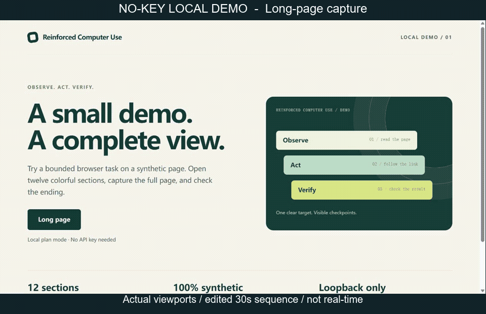

# Reinforced Computer Use for Codex

[English](README.md) · [简体中文](README.zh-CN.md)

**A Windows-first Codex plugin for multi-step UI workflows and long-page capture, with optional Jev planning.** Follow a scoped local plan, observe the interface again before each action, and check the result locally. The default mode needs **no API key**.

[](package.json)
[](https://github.com/Steven2007yhq/Reinforced-Computer-use-in-Codex/actions)
[](package.json)
[](LICENSE)



*An edited screenshot sequence of the local synthetic demo, not a real-time recording or a performance benchmark. No Jev provider is called. See [the demo procedure and verification](docs/DEMO.md), including the [first](docs/assets/demo-top.png) and [last](docs/assets/demo-bottom.png) captured viewports.*

**Start here:** [Install and run your first task](docs/GETTING_STARTED.md) · [Reproduce the demo](docs/DEMO.md) · [Troubleshooting](docs/TROUBLESHOOTING.md) · [Releases](https://github.com/Steven2007yhq/Reinforced-Computer-use-in-Codex/releases)

## What you can do

| Feature | Example | Requirements |
| --- | --- | --- |
| **Scoped local workflows** | Open a known sequence of pages using observed control labels, then verify the destination | An enabled Computer Use surface; no Jev account or API key |
| **Sky native Windows adapter** | Bind an exact returned window and convert its state, element numbers, screenshot coordinates, and keyboard chords | The existing `@oai/sky` window2 service in `node_repl`; indexed workflows need usable accessibility text |
| **Multi-stage native continuation** | Preserve progress across scoped Jev decisions and Codex screenshot checks | Fresh local stage verifiers; Codex still grounds visual actions and handles required reviews |
| **Read-only delayed verification** | Wait for a saved file or updated AX state after an already attempted input | Fresh read-only observations and strict scope/result predicates; no input or Jev request |
| **Long-page capture** | Scroll a selected browser tab, stitch viewport captures, and check the first and last sections | A browser surface with screenshot, scroll, keyboard, and read-only page-metric APIs |
| **Optional Jev planning** | Choose the next action from a restricted set when the UI can branch | Provider configuration, a valid key, a local bridge, and explicit sharing of planning metadata |

Codex supplies the goal, permission, prepared text, visual judgment, and final inspection. The plugin sets action and time budgets and checks the task scope. Recognized sensitive controls, uncertain state, and failed verification hand control back to Codex. Label rules are helper checks; they cannot detect every consequential action or replace the current Computer Use permission policy.

“Reinforced” is the project name. This repository provides an execution helper; it does not train or distribute a reinforcement-learning model. No universal speedup has been measured.

## Check your environment

The verified development environment is **Windows 11 x64 with Node.js 24.14.0**; the source requires **Node.js 22 or later**. You also need Git, npm, PowerShell, and a Codex installation that supports local plugin marketplaces and `codex plugin add`.

**Computer Use must already be available in your Codex chat. Installing this plugin does not enable it.** Browser workflows require an enabled browser surface. The new native Windows path uses the documented `@oai/sky` window2 client in `node_repl` and binds one exact returned `Window`. Existing native CUA app targets remain supported when that surface is available.

| Device / platform | Current status |
| --- | --- |
| Windows 11 x64 desktop or laptop | Primary development platform; UI support depends on the available browser or native Computer Use surface |
| Windows 10, Windows ARM64, macOS, Linux | Deployment and native UI operation are unverified |
| Android / iOS phones and tablets | Unsupported deployment targets |

Jev runs through a cloud provider, so this plugin does not require a GPU for local Jev inference. CPU, RAM, GPU, and VRAM minimums have not been established. Read [compatibility and device requirements](docs/COMPATIBILITY.md) for the full conditions (Chinese).

## Install on Windows

In PowerShell:

```powershell
git clone https://github.com/Steven2007yhq/Reinforced-Computer-use-in-Codex.git
cd Reinforced-Computer-use-in-Codex
npm ci --omit=dev --ignore-scripts
.\scripts\install-windows.ps1
```

Install dependencies before running the installer. It copies the published package content and its two screenshot dependencies to your user plugin directory, registers the local marketplace, and invokes Codex plugin installation. Existing marketplace content is preserved and backed up. If the target plugin directory already exists or the marketplace root conflicts, it stops so you can inspect the conflict.

Restart Codex and start a new chat after installation. For step-by-step checks and installation details, see [Getting started](docs/GETTING_STARTED.md).

## Try the no-key demo

From your source checkout, keep this terminal open:

```powershell
npm run demo
```

In a new Codex chat with the plugin and browser Computer Use available, paste:

> Use Reinforced Computer Use in local runPlan mode, without Jev. Open http://127.0.0.1:4318/ in the Computer Use browser. Observe the page, use the exact “Long page” link, and verify LONG_01 on the destination. Capture that long page as a PNG in this chat's workspace output directory. Inspect the saved image for LONG_01 through LONG_12 in order and END_OF_LONG_PAGE at the bottom. Report the document height, captured height, and coverage from the helper. Stop and explain if the required Computer Use APIs are unavailable.

The page contains synthetic content and requires no login or provider key. Starting the local server alone does not exercise the plugin: the Codex task must use `runPlan()` and `captureLongPage()` through the selected CUA tab. Full prompts, the adjustable port, expected markers, and verification boundaries are in [DEMO.md](docs/DEMO.md).

## Choose an execution mode

Use **`runPlan()`** for a workflow whose permitted steps are already known. Use **`runAdaptive()`** only when you need Jev to choose among currently allowed actions. Use ordinary Computer Use for a single action, visual reasoning, canvas, drag-and-drop, file pickers, inaccessible controls, and consequential final steps.

Sessions bind an exact tab or window, allow observed labels, restrict browser origins, define a local `verify()` predicate, and set step/time budgets. A `done` result means that predicate passed; inspect the final state or screenshot before reporting success. If scope changes or an action is uncertain, inspect fresh state instead of replaying it. The full session API and bootstrap examples are in the [Codex skill](skills/reinforced-computer-use/SKILL.md).

For native Windows apps, first read the installed Computer Use skill, initialize `sky` with `await import('@oai/sky')` in `node_repl`, and inspect `sky.list_windows()` or `sky.list_apps()`. Select exactly one returned window, then create the target with `createSkyTarget({sky, window: selectedWindow})` from `scripts/sky-adapter.mjs`. Observe its accessibility tree before allowing actions. The adapter preserves native element numbers, replaces prepared fields with one `set_value` call, retains selected screenshot-region coordinates, and converts keyboard chords to Sky keysyms. Point clicks also preserve valid `mouse_button` and `click_count` options, so an explicit right-click or double-click is no longer silently converted to a single left-click. See [the native adapter reference](skills/reinforced-computer-use/references/sky-adapter.md).

Screenshot/image inputs require the current observation generation; physical screen inputs require an explicitly known scale. Missing accessibility, changed bindings, uncertain input, or failed verification hands the workflow back for inspection. These checks do not guarantee arbitrary application compatibility. Version 0.3.0 also supports importing the provider and bridge client in a REPL without global `process`; pass the bridge descriptor path observed in the terminal, and keep credential handling in that terminal.

Version 0.4.0 adds `createWorkflow()` for ordered stages and grounded `prepare()`/`commit()` for Codex screenshot continuation when native AX is weak or null. Jev selects one already allowed semantic action. Codex then inspects a new screenshot, binds the exact window, grounds that same action and executes it once through supported Computer Use. Jev receives no screenshot or coordinates. See [workflows](skills/reinforced-computer-use/references/workflow.md) and [grounded actions](skills/reinforced-computer-use/references/grounded-actions.md).

```js
var workflows = await import('file://PLUGIN_ROOT/scripts/workflow.mjs');
var task = workflows.createWorkflow({
  session, observe:captureFreshTarget, scopeCheck:sameApprovedTarget,
  stages:[
    {id:'open', needsReview:true, run:() => 'needs_codex_review', verify:documentIsLoaded},
    {id:'play', needsReview:true, run:() => 'needs_codex_review', verify:playbackActuallyAdvanced},
  ],
  verify:requestedFinalState,
});
var progress = await task.run({maxStages:1});
```

The callbacks are local, app-specific functions supplied by Codex after inspection. Both native stages pause before input. Capture and end an observation-only cell, let Codex inspect its result, then commit one grounded input and immediately refresh in the next cell. Keep `maxStages:1` at these visual boundaries, retain the local handoff ticket/revision and use `task.resume()` after independently checking the pending result. Resume verifies rather than replaying the stage input. These helpers do not supply application business logic, give Jev visual perception, or establish autonomous operation of arbitrary software. `latencyMs` measures client-side provider-request elapsed time, not server compute or the user's full task time.

Use [`waitForVerified()`](skills/reinforced-computer-use/references/read-only-verification.md) from `scripts/read-only-verification.mjs` when local feedback arrives late after an attempted input. It polls fresh read-only observations within a cooperative time budget, checks strict boolean scope and result predicates, and makes no input, replay, or provider call. Keep its callbacks read-only; screenshot-only effects still need Codex's separate visual inspection. The helper supports the restricted REPL without global `EventTarget` or `process`; a native read that ignores cancellation can still outlast its deadline.

The separate [0.4.0 full-flow acceptance](docs/acceptance-fullflow-2026-10-05.md) passed the tested **mixed Jev + Codex** workflows in Multisim and Jianying Pro. Multisim reopened the saved R1 value as **1.2 kΩ**, then an actual Run produced a waveform with SCP data supporting approximately **5 kHz / 0.504 Vpp**. The patched double-click reopened properties, and a right-click opened the native context menu without selecting a menu mutation. Jianying imported the independent test clip, placed it on the timeline, played it, and exported a fresh **818 × 432, 30 fps, 154-frame MP4**, with a container duration of **5.155011 s** and a full ffmpeg decode exit code of **0**. Jev chose scoped semantic actions; Codex grounded and executed inputs and handled application-specific steps. Theoretical circuit comparison is only a sanity check, not proof of how the solver used an internal cache. The component-selector/native-service hang observed during testing required recovery and remains an unresolved compatibility boundary.

The [basic Office, ChatGPT web and Canva checks](docs/acceptance-office-ai-canva-2026-10-05.md) and [desktop/WPS/advanced Office acceptance](docs/acceptance-desktop-wps-advanced-office-2026-10-06.md) add bounded real-app evidence. The latter verified Claude desktop and Doubao web replies, WPS document and spreadsheet editing, preservation/export of a prepared six-page Word layout, recalculation of 100000 Excel records with 300003 saved formula caches, and one actual Excel VBA import/run/save flow. These checks include Codex/Sky/CUA handoffs. WPS macro execution still requires its missing macro component; desktop Doubao was not available in the checked discovery scope, and WPS displayed a missing-fonts warning. See the [compatibility matrix](docs/COMPATIBILITY.md) for the tested surfaces and remaining limits.

## Optional: connect Jev

Local mode and the demo work without Jev. Adaptive mode needs TypeSafe or OpenRouter configuration, the relevant user environment variable, a retained loopback bridge process, and `shareWithPlanner: true` with a scoped `plannerGoal`. Follow [the setup instructions](docs/GETTING_STARTED.md#optional-jev-setup) or the [detailed Jev reference](skills/reinforced-computer-use/references/jev-setup.md).

Planning requests can disclose the target name, goal, allowed control labels, observation names, prepared slot names, and recent action descriptions. Prepared text values and screenshots are excluded from the default planning JSON, but entered text can still be sent by the target application or website. Your API key is sent to your selected provider in its HTTPS authorization header. The historical [0.3.0 native acceptance](docs/acceptance-native-2026-10-05.md) recorded ten real TypeSafe responses identifying `jev-1.13.0`, including permitted decisions in Multisim and Jianying Pro. Those workflows also required ordinary Codex/Sky handoffs for file selection, editing, media import, timeline placement, and export; they do not establish full autonomous operation or validate the new 0.4.0 continuation path. This record does not guarantee current provider availability, other accounts, billing, OpenRouter access, or other applications. Read [privacy and data flow](docs/PRIVACY.md) before enabling sharing (Chinese).

## Development and evidence

```powershell
npm ci --omit=dev --ignore-scripts
npm test
npm run check:release
```

The runtime and screenshot helpers are in `scripts/`; the Codex skill is in `skills/reinforced-computer-use/`; tests are in `tests/`. [Verification records](docs/VERIFICATION.md) distinguish mock tests, the local browser demo, tested native/provider actions with Codex handoffs, historical acceptance, and unverified production paths. CI runs mock tests on Windows/Ubuntu and Node 22/24; passing Ubuntu CI does not prove Linux desktop compatibility.

If you try the demo, an issue stating your OS, Node version, available CUA surface, reproduction steps, and expected versus observed result is useful. Remove private labels, credentials, local paths, screenshots, bridge descriptors, and traces before sharing. Follow [troubleshooting](docs/TROUBLESHOOTING.md) and [the security reporting policy](SECURITY.md).

If the project helps with your Codex workflows, a star makes it easier to find again. You can also watch releases for version updates.

## License and attribution

This plugin and its documentation are released under the [MIT license](LICENSE). See [NOTICE](NOTICE) for dependency and reference attribution. Codex, the Computer Use runtime, and Jev models/services are provided separately and are not distributed by this repository.
